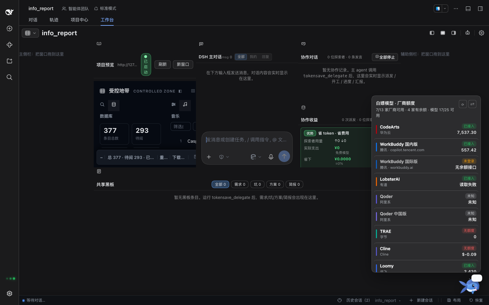

# dsh-model-float

在 DSH 主界面挂一只可拖动的**鲸鱼娘浮动面板**，鼠标放上去就能看到白嫖模型
各厂商的接入状态、剩余积分与余额——不用再一次次点进
「设置 → Our Free Model → 白嫖模型接入」。

> A draggable whale-girl floating panel in the DeepSeek Harness web shell.
> Hover it and every free-model vendor shows up with its connection state and
> the credit it still has.

---

## 效果

| | |
|---|---|
| 浮动鲸鱼娘 | 挂在屏幕任意位置，可拖动、可换角，位置记在浏览器本地 |
| 悬停展开 | 鼠标移上去（键盘聚焦或点击同样）即展开卡片 |
| 厂商表 | 13 家渠道各自的接入状态 + 剩余积分/余额（按各家自己的单位） |
| 模型可用性 | 可展开每个模型的可用 / 地区限制 / 不可用 / 限流 |
| **清理模型列表** | **一键把不可用厂商的模型从对话框的模型选择器里隐藏** |



## 数据来源

面板不新增任何后端接口，只读宿主机**已经在提供**的两个同源数据面：

| 数据面 | 回答的问题 |
|---|---|
| `GET /api/our-free-model/summary` | 免费通道现在有哪些模型？每个在本机**能不能用**？ |
| `POST /api/channel-pack` → `provider.status` | 每家厂商有多少模型、多少账号、启用了吗？ |
| `POST /api/channel-pack` → `credits.balances` | 每家厂商的账号**还剩多少**积分/余额？ |
| `POST /api/channel-pack` → `model.list` | 这家厂商哪些模型已经被隐藏了？ |

写入只有一个入口：

| 写入面 | 作用 |
|---|---|
| `POST /api/channel-pack` → `model.setDisabledMany` | 批量隐藏／恢复某厂商的模型 |

也就是说，面板显示的就是「白嫖模型接入」那一页的数据，只是把它压缩成一眼能看懂的
样子。要看更多（领积分、登录、模型黑名单），仍然是回设置页。

**依赖**：本插件需要 `dsh-our-free-model` 在场（它提供上面两个数据面）。缺了它，
面板会显示「读取失败」，其余部分照常工作。

## 清理模型选择器

模型选择器里塞了 600 多个条目（光是 Cline 一家就 475 个），翻起来很费劲。
面板因此多了一个「**清理**」按钮，和每家厂商行尾的一个 `✕`：

- **行尾 `✕`**：隐藏这一家厂商的全部模型；隐藏后变成 `↩`，点它恢复。
- **卡片右上角「清理」**：一次性隐藏**所有不可用厂商**的模型。

隐藏走的是 Channel Pack 的模型黑名单，模型选择器每次列目录都读它，
所以改完立刻生效，不用刷新页面。

本机实测：模型选择器从 **631 个条目降到 92 个**。

### 什么算「不可用」

只有两种情况会被自动清理：

1. **厂商没接上**——已关闭、未登录、或根本没有账号；
2. **厂商接上了但没额度**——余额 ≤ 0。

**余额查不出来的不算**。那是个「不知道」，不是「用不了」——按未知去隐藏，
会把能用的模型也弄没了。所以 LobsterAI 这种「查询失败」的情况会原样留着，
需要的话你手动点它的 `✕`。

### 恢复的边界

黑名单是设置页和面板共用的：你在设置页手动关掉的模型，理论上不该被面板的
「恢复」顺手打开。所以面板在 `localStorage` 里记了一份「自己关过哪些」，
恢复时只动这份。

但这份记录会丢（换浏览器、清站点数据、换机器），这时面板分不清
「你手动关的」和「我关的」——那就**全部恢复**。理由很直接：这些模型是被某个
动作藏起来的，一直藏着是更糟的失败；你随时可以再关一次。

## 安装

```bash
# 在 profile 目录里加一条 link 依赖
cd ~/.dsh/profiles/web
python3 - <<'PY'
import json, collections
p = 'package.json'
d = json.load(open(p), object_pairs_hook=collections.OrderedDict)
d['dependencies']['dsh-model-float'] = 'link:/absolute/path/to/modelfloat'
b = d['dsh']['profile']['bundles']
if 'dsh-model-float' not in b:
    b.insert(b.index('dsh-our-free-model') + 1, 'dsh-model-float')
json.dump(d, open(p, 'w'), indent=2, ensure_ascii=False)
open(p, 'a').write('\n')
PY
pnpm install
```

然后把本包挂进 profile 的 `bundles`（见上一步已写好的 `package.json`），重启
`dsh web`。开发中也可以用 `--patch` 临时挂载。

## 开发

```bash
pnpm install     # esbuild + react + typescript
pnpm build       # client/src → dist/client.js
pnpm check       # tsc --noEmit
```

产物 `dist/client.js` 必须是客户端模块系统认得的 **classic-script** 形态：

```js
window.__ModuleLoader__.load({ id: 'dsh-model-float', factory: require => { /* … */ } })
```

`react` / `react-dom` 走运行时模块表（平台种子），在 esbuild 里标为 external。

## 结构

```
src/index.js            宿主半边（空 —— 这是一个纯浏览器插件）
client/src/index.tsx    浏览器半边：注册 shell.overlay 槽位、轮询读数
client/src/panel.tsx   浮动面板：鲸鱼娘按钮 + 悬停卡片 + 拖拽定位
client/src/whale.tsx   鲸鱼娘 SVG（手绘，无外部资源）
client/src/data.ts     数据面的读取与聚合 + 模型黑名单的读写
client/src/styles.ts   样式（只用 shell 的 --dsw-alias-* 主题变量）
scripts/build-client.mjs  esbuild 打包 + ModuleLoader 信封
```

## 交互细节

- **拖动**：按住鲸鱼娘拖到任意位置，松手即固定；位置存 `localStorage`，刷新后还在。
  位置会被夹在视口内，换了屏幕尺寸也不会把鲸鱼弄丢。
- **换角**：卡片右上角的 `⇄` 按钮把面板吸到下一个角落（键盘与触屏用户用这个）。
- **悬停**：移上去 220ms 后展开，离开 260ms 后收起（避免路过时闪一下）。
  键盘 `Tab` 聚焦鲸鱼娘也会展开，`Esc` 收起。
- **点击**：点一下切换开合（触屏与不方便悬停的场景）。
- **刷新**：卡片右上角的 `⟳` 立刻重读一次；平时每 90 秒自动读一次，页面切回前台时也会读。
- **清理**：卡片右上角的「清理」隐藏所有不可用厂商的模型；每家厂商行尾的 `✕`／`↩` 单独开关一家。

## 已知限制

- 余额是**逐账号顺序**向上游查的（Channel Pack 的既有约定，避免并发触发风控），
  所以 13 家厂商的首次读数可能要几秒；卡片会先把已知的数据显示出来。
- `WorkBuddy 国际版` 没有余额接口（上游不提供），面板如实写「无余额接口」，
  不会显示成 0——0 的语义是「已用光」，混淆会误导。
- 某些厂商（如 LobsterAI）查不到余额时显示「读取失败」并把原因放在行首的
  `title` 里，同样不显示成 0。

## Model Experience

无。面板是浏览器侧 UI，不注册任何面向模型的内容。

#### KV Cache 影响

无。这个插件不进入模型上下文，不改变任何 prompt、工具 schema 或请求体。

## 许可

MIT
